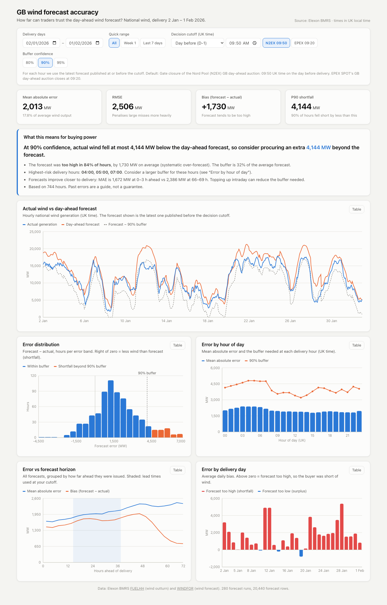
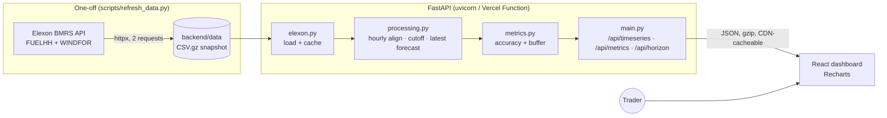

# GB Wind Forecast Accuracy

A dashboard for a UK energy utility that buys electricity on the GB day-ahead market. It answers two questions:

1. **What was the latest national wind forecast available when the day-ahead purchase decision was made?**
2. **How wrong is that forecast typically, and how much extra power should traders buy to cover the error?**

Scope: national-level **wind** only, **Elexon BMRS** data only, purchase decisions made in **January 2026**.

**Live demo:** _to be added after deployment_ · **API docs:** `/api/docs` on any running instance



---

## Key findings (January 2026, default 09:50 D-1 cutoff)

| Metric | Value |
|---|---|
| Mean absolute error (MAE) | **2,013 MW** (17.8% of average wind output of 11,284 MW) |
| RMSE | 2,506 MW |
| Bias (forecast − actual) | **+1,730 MW**: the forecast was too high in 84% of hours |
| Error percentiles P10 / P50 / P90 | −489 / +1,560 / **+4,144 MW** |
| Recommended buffer | **80%: 3,073 MW · 90%: 4,144 MW · 95%: 5,322 MW** |

- **The day-ahead forecast systematically over-predicts metered wind output.** The over-prediction persists even for forecasts issued 0–6 h ahead (+1,428 MW bias), and for forecast values published after the hour had already started (+1,666 MW). So it is not weather uncertainty.
- **Most of the bias is curtailment, not missing wind.** An offline check of 60 random half-hours ([verification](#independent-verification)) used Elexon's Physical Notification (PN) and Bid-Offer Acceptance (BOALF) data. On average the system operator cut wind output by **1,250 MW** through accepted bids, against a forecast-minus-FUELHH bias of 1,665 MW in the same half-hours. That is **about 75% of the bias**. Adding the curtailed volume back reduces the bias to about 415 MW and MAE from 1,878 to 1,169 MW. The pattern matches the level analysis: when the forecast exceeds 15 GW the average over-forecast is 2.75 GW, below 5 GW only 136 MW, and actual output never exceeds 17.8 GW while forecasts reach 21.3 GW. WINDFOR appears to track what wind farms *could* generate (close to their PNs), while FUELHH records metered output after curtailment.
- **What that means for buyers:** curtailed wind is replaced by other generation that the system operator dispatches, and the curtailed farms are paid for their bids. Whether a buyer must cover that "shortfall" depends on their contract position. If they don't, the buffer below overstates their real risk.
- **Accuracy improves closer to delivery.** MAE rises from 1,660 MW for forecasts issued 0–6 h ahead to about 2,330 MW at 42 h+. The forecasts actually used at a D-1 09:50 cutoff are 14.5–37.5 h ahead.
- **Cutoff choice matters a little; the decision day matters a lot.** EPEX (09:20) uses the 07:30 forecast: MAE 2,039 MW. N2EX (09:50) can use the 09:30 forecast: MAE 2,013 MW. Deciding two days ahead (D-2) raises MAE to 2,484 MW, and the forecast no longer covers the last hours of the delivery day (91.7% coverage).
- **Worst days:** 28 Jan (forecast 11.1 GW vs actual 5.8 GW on average) and 11–12 Jan (about 4.9 GW over-forecast).

---

## How to run

### Docker (recommended)

```bash
docker compose up --build
```

- Dashboard: <http://localhost:8080>
- API + Swagger docs: <http://localhost:8000/api/docs>

### Local development

Requirements: Python 3.12+, Node 20+.

```bash
# Backend
cd backend
python3.12 -m venv .venv
.venv/bin/pip install -r requirements-dev.txt
.venv/bin/uvicorn app.main:app --reload --port 8000

# Frontend (second terminal). Vite proxies /api to 127.0.0.1:8000
cd frontend
npm install
npm run dev            # http://localhost:5173
```

### Tests

```bash
cd backend && .venv/bin/pytest -q          # 29 tests
cd frontend && npm run lint && npm run build  # type-check + lint
```

### Refresh the data snapshot

The January data is committed in `backend/data/` (about 110 KB gzipped), so nothing calls Elexon at runtime. To re-download it:

```bash
cd backend && .venv/bin/python -m scripts.refresh_data
```

---

## Independent verification

Three scripts in `backend/scripts/` check the app's results from outside. They use only the Python standard library, download data straight from Elexon and never import app code. The first two can compare themselves with a running app over HTTP.

```bash
cd backend
.venv/bin/uvicorn app.main:app --port 8000 &       # only needed for the comparisons

python scripts/verify_trace_hours.py --seed 4152 --api http://localhost:8000
python scripts/verify_metrics.py http://localhost:8000
python scripts/verify_curtailment.py               # about 30 s; --periods <ISO times> for specific half-hours
```

| Script | What it checks | Result |
|---|---|---|
| `verify_trace_hours.py` | For random hours: both FUELHH half-hours, their mean, every WINDFOR forecast with its `publishTime`, and which one the 09:50 D-1 cutoff selects | Seed 4152: 3/3 hours identical to the app; no forecast published after the cutoff is ever used |
| `verify_metrics.py` | Re-implements selection and metrics (stdlib only, no pandas or numpy) on a fresh download | n, MAE, RMSE, bias, P10, P50 and P90 identical to the app's `/api/metrics`. This also confirms the committed snapshot matches Elexon today |
| `verify_curtailment.py` | Wind units' PN (planned output) and BOALF (output instructed after accepted bids) vs FUELHH and WINDFOR | Curtailment explains about 75% of the bias (60 random half-hours, seed 7) |

**Scope decision:** the brief says to use only FUELHH and WINDFOR, so **the app itself uses only those two datasets**. The PN/BOALF curtailment analysis exists only as the offline script above and this README note; it is not a dashboard feature. The dashboard's buying-advice card mentions the finding as one line of static text.

---

## Files and directories

```
.
├── backend/                      FastAPI service
│   ├── app/
│   │   ├── config.py             Study window, Elexon URLs, default cutoff (09:50 D-1)
│   │   ├── elexon.py             Elexon BMRS client + on-disk CSV cache
│   │   ├── processing.py         Hourly alignment, decision cutoff, latest-forecast selection
│   │   ├── metrics.py            MAE, RMSE, bias, nMAE, percentiles, by hour/day, horizon, buffer
│   │   ├── analysis.py           Glue: loads data once, memoises results per parameter set
│   │   ├── schemas.py            Pydantic response models (the API contract)
│   │   └── main.py               REST endpoints, validation, cache headers, gzip
│   ├── data/                     Committed January 2026 snapshot (FUELHH + WINDFOR)
│   ├── scripts/
│   │   ├── refresh_data.py       Re-downloads the snapshot
│   │   ├── verify_trace_hours.py Independent trace of random hours vs the app
│   │   ├── verify_metrics.py     Independent recomputation of the headline metrics
│   │   └── verify_curtailment.py Offline PN/BOALF check of the bias (not used by the app)
│   ├── tests/                    pytest: processing, metrics, API
│   ├── requirements.txt          Runtime dependencies (pinned)
│   ├── requirements-dev.txt      + pytest
│   └── Dockerfile
├── frontend/                     React + TypeScript + Vite + Recharts
│   ├── src/
│   │   ├── App.tsx               Page layout and shared filter state
│   │   ├── api.ts, types.ts      Typed API client mirroring backend schemas
│   │   ├── hooks/                useApi (fetch/abort/keep-previous), useChartTheme, useDebounced
│   │   ├── components/           Controls, KpiCards, BuyingAdvice, 5 chart components, ChartCard
│   │   ├── format.ts             MW / time formatting (UK local time)
│   │   └── index.css             Design tokens (light + dark), responsive layout
│   ├── nginx.conf                Serves the build and proxies /api in Docker
│   └── Dockerfile                Multi-stage: Node build, then nginx
├── docker-compose.yml            backend :8000 + frontend :8080
├── vercel.json                   Vercel Services: /api/* → backend, everything else → frontend
└── docs/dashboard.png
```

---

## Architecture



**Request path:** the browser always calls same-origin `/api/...`. In dev the Vite proxy forwards it, in Docker nginx does, and on Vercel a Services rewrite does. The backend serves every route under `/api`, so no path rewriting is needed anywhere.

**Why it fits Vercel's serverless limits:** the dataset is tiny (about 20k forecast rows), so it ships inside the function bundle instead of being fetched from Elexon per request. Data is parsed once per warm instance, and results are memoised per parameter set (cold metrics request about 0.6 s, warm about 5 ms). Responses carry `s-maxage` so Vercel's CDN can serve repeat requests without invoking the function.

---

## API

All endpoints are `GET`, return JSON and accept these common query parameters:

| Param | Default | Notes |
|---|---|---|
| `start`, `end` | `2026-01-02`, `2026-02-01` | UK delivery days, inclusive; must lie in the study window |
| `cutoff_time` | `09:50` | Decision cutoff, UK local time (`HH:MM`) |
| `cutoff_days_before` | `1` | 1 = D-1, 2 = D-2 |

| Endpoint | Extra params | Returns |
|---|---|---|
| `/api/health` | none | `{"status": "ok"}` |
| `/api/meta` | none | Study window, defaults, cutoff rationale, row counts |
| `/api/timeseries` | none | Hourly points: `actual_mw`, `forecast_mw`, `publish_time`, `horizon_h`, `error_mw` |
| `/api/metrics` | `confidence` (0.5–0.99, default 0.9) | `summary`, `by_hour`, `by_day`, `histogram`, `recommendation` |
| `/api/horizon` | `bucket_hours` (1–12, default 3) | MAE / RMSE / bias per lead-time bucket, using **all** forecasts |

Invalid parameters return `422` with a readable `detail`. Full schema: `/api/docs` (Swagger) or `/api/openapi.json`.

---

## Key domain decisions

### 1. Which days are in scope
A purchase decision on day D-1 is for delivery on day D. Decisions made **1–31 Jan 2026** therefore cover **delivery days 2 Jan – 1 Feb 2026**. The delivery day is the **UK local calendar day** (00:00–24:00).

### 2. Decision cutoff (default 09:50 UK time on D-1)
The default is the gate closure of the **Nord Pool (N2EX) GB day-ahead auction, 09:50 UK time** on the day before delivery. The **EPEX SPOT GB day-ahead auction closes at 09:20** and is offered as a preset. Both times were set when GB left EU market coupling (previously 11:00). Sources:
[Nord Pool: GB auction changes for Brexit](https://nordpoolgroup.com/en/message-center-container/newsroom/exchange-message-list/2020/q4/nord-pool-announces-gb-auction-changes-for-brexit) ·
[EPEX SPOT: new timing of GB day-ahead auction](https://epexspot.com/en/news/exchange-council-welcomes-new-timing-gb-day-ahead-auction).
The cutoff time and days-before are configurable in both the API and the UI. The cutoff is computed in UK local time, so it stays correct across BST/GMT changes (tested).

### 3. Data and alignment
| | FUELHH (actuals) | WINDFOR (forecasts) |
|---|---|---|
| Filter | `fuelType=WIND`, by settlement date | by `publishTime` |
| Resolution | **30 min** | **hourly** |
| Publishing | after each period | 8 runs/day, each about 3 days ahead. In GMT months `publishTime` is 02:30, 04:30, 07:30, 09:30, 11:30, 15:30, 18:30, 22:30 UTC; in BST months each is one hour later in UTC |

Actuals are **averaged to hourly means** (the two half-hours starting at hh:00 and hh:30) and compared with the hourly forecast for hh:00. Hours missing either half-hour are dropped.

**Why average:** the hourly forecast describes a whole hour, so comparing it with the mean of that hour's two half-hours puts both on the same hourly-energy basis, which is also how day-ahead power is traded. Using both half-hours keeps all the data and smooths half-hour noise.

**Caveat on the alignment window:** Elexon does not document whether a WINDFOR value at `startTime` hh:00 describes the hour starting or ending at hh:00. We use "hour starting", matching how FUELHH uses `startTime`. The data slightly favours "hour ending": decision-window MAE is 1,927 vs 1,981 MW, and 1,637 vs 1,670 MW for 0–3 h forecasts. Across all alignment variants tested, MAE moves by about 3% and the bias by under 20 MW, so no conclusion changes.

**Caveat on `publishTime`:** selection trusts each forecast's `publishTime` as the moment it became available. Elexon's docs list the schedule as 03:30, 05:30 …, which matches the summer UTC values but is an hour later than January's values. If the 09:30 forecast actually became public after the 09:50 cutoff, the app should have used the 07:30 forecast instead. That is exactly the EPEX 09:20 preset: MAE 2,039 vs 2,013 MW and P90 4,098 vs 4,144 MW, a change of about 1%.

### 4. Forecast selection
For each target hour *t*, use the forecast with the **latest `publishTime` such that `publishTime ≤ cutoff(t)` and `publishTime ≤ t`**. Hours with no eligible forecast are excluded and reported as `coverage_pct`.

### 5. Metric definitions
`error = forecast − actual` (MW). **Positive error = less wind arrived than forecast = the buyer is short.**

| Metric | Definition |
|---|---|
| MAE | mean(\|error\|) |
| RMSE | √mean(error²): penalises large misses |
| Bias | mean(error); positive = forecast too high on average |
| nMAE (% of mean actual) | Σ\|error\| / Σactual. Used instead of MAPE, which explodes in low-wind hours |
| nMAE (% of max actual) | MAE / max(actual) in the period |
| P10 / P50 / P90 | Percentiles of signed error (linear interpolation) |
| Error by hour / day | The above grouped by UK local hour of day / delivery day |
| Horizon curve | All forecasts (cutoff ignored) grouped by lead time = target − publish, in 3 h buckets; negative lead times dropped |

### 6. Procurement buffer
`buffer = max(0, quantile(error, confidence))`. If the trader buys **forecast + buffer**, the historical shortfall was covered in `confidence` of hours. The dashboard also shows a per-hour buffer and a "forecast − buffer" planning line.

---

## Limitations

- **One month of history.** The buffer is an empirical quantile of January errors and assumes future errors look similar. Winter wind patterns differ from summer.
- **The buffer is unconditional.** It does not depend on the forecast level, even though errors clearly grow with it (see findings).
- **Errors are measured against metered output, which includes curtailment.** About 75% of the bias is output cut by the system operator (see findings). The remaining ~400 MW is unexplained: it could be genuine over-forecasting, the curtailment script's simplified acceptance model, or units that appear in one dataset but not the other.
- **Forecast availability is assumed equal to `publishTime`** (about 1% impact if a forecast was published late; see domain decisions).
- **Hourly comparison.** Half-hourly variation inside each hour is averaged away, and the WINDFOR hour convention is undocumented (about 3% MAE sensitivity).
- **Lead-time buckets beyond about 48 h have fewer samples** because only some target hours have forecasts that far ahead. Pair counts are shown in the horizon table.
- **Static snapshot.** No scheduled refresh, which is intentional for a fixed historical study.
- **Calendar-day delivery.** Exchange-specific delivery-day conventions are simplified to the UK calendar day.

## Next steps

1. **Conditional buffer:** buffer by forecast level and hour of day (quantile regression), which should shrink the buffer in low-wind hours.
2. **Bias correction:** a simple linear correction of the forecast, then re-evaluate.
3. **Cost-aware sizing:** choose the confidence level by trading off day-ahead price against imbalance (cash-out) price.
4. **Curtailment-aware view (if the scope allows more datasets):** show errors against "uncurtailed" output (FUELHH + accepted bids), so buyers can size the buffer against the risk they actually carry.
5. **More history and live data:** extend to 12+ months, with a scheduled refresh to object storage (e.g. Vercel Cron + Blob).
6. **Frontend tests** (Vitest + Testing Library) and CI running pytest, lint and build on each push.

---

## AI tools used

This project was built with **Claude Code** (Anthropic) as a pair-programming assistant. It explored the Elexon API, researched the auction gate-closure times, scaffolded and wrote code and tests, wrote the independent verification scripts, checked the UI via headless-browser screenshots, and drafted this README. All design decisions (cutoff logic, alignment, metric definitions, sign convention, deployment architecture) were reviewed and can be explained by the author.
